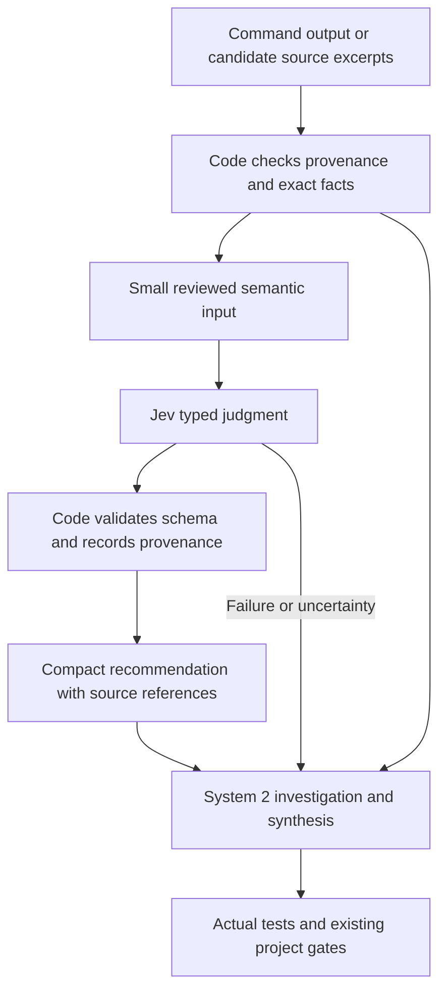

# Jev in the development flow

Research spike completed on 2026-10-04 by the kaizen line using the TypeSafe skill.
The experiment used `jev-1.13.0`. This report proposes a subsequent pilot and does
not change development gates or activate automatic workflow decisions.

## Findings against the two objectives

| Objective | Verified result | Conclusion |
|---|---|---|
| Stretch System 2 subscription usage | Eighteen Jev requests cost an estimated USD 0.001896426 at the published rate. Semantic routing and excerpt relevance matched all 40 corresponding labels. | A low service cost is established. Net System 2 token savings and subscription capacity gains remain unmeasured. |
| Reduce errors in larger System 2 tasks | Claim classification matched 18 of 20 fixed labels. Both disagreements persisted across repetition and reordered criteria. Neither was a false `supports` answer. | Jev is a plausible supplementary check. Error-free judgment and end-to-end error reduction are not established. |

Recommendation. Begin with a bounded shadow pilot for diagnostic routing and
claim-to-evidence checks. Record its recommendations without allowing them to
suppress required work. Evaluate retrieval separately before using it to omit
context. Keep exact checks in code, and keep planning, implementation and complex
reasoning with System 2.

The error-free premise is unsupported. TypeSafe itself documents problems with
numerical precision, indirection, adversarial content and option order. The
project should treat Jev as a fallible semantic classifier.
[TypeSafe model limitations](https://docs.typesafe.ai/model-jaggedness/jev-1.13)

## Capability and evidence boundaries

Jev returns typed choices, scores and yes probabilities. It does not generate
code, execute tools or replace the model driving a coding agent. Delegation here
means calling a small decision service from a workflow tool, not assigning Jev
a development objective or an interline mailbox.
[Jev with coding agents](https://docs.typesafe.ai/introduction/coding-agents)

Type safety constrains the answer representation. It does not prove that the
answer is true. Choice confidence is derived from probability concentration.
A value of 0.90 is not evidence of a 90 percent success rate on this repository.
Noul returns a yes probability without a separate confidence field.
[Confidence reference](https://docs.typesafe.ai/confidence)

There is prior research supporting learned cascades of models as a way to trade
cost against accuracy. That establishes a useful research direction, not a Jev
result or a saving under this operator's subscription.
[FrugalGPT](https://arxiv.org/abs/2305.05176)

The local motivation is concrete. The preceding
[process delta audit](./2026-10-04-process-delta-audit.md) found a large process
surface and recurring gaps between an asserted completion and its supporting
receipt. Current policy already reserves exact decisions such as revision
identity, mandatory gates and operator authority to their actual evidence.
Jev should help locate or question evidence, not become that evidence.

## Experiment and reproducible evidence

The [protocol](./evidence/jev-flow/PLAN.md),
[fixtures](./evidence/jev-flow/fixtures.json) and
[runner](../../../scripts/jev_flow_spike.py) were fixed before live calls.
The [receipts](./evidence/jev-flow/receipts.jsonl) preserve every request and valid
response, timestamps, usage and source digests. The
[summary](./evidence/jev-flow/summary.json) is generated offline.

There are 60 distinct synthetic cases in three equal families. Each family was
split into batches of ten cases. Every batch was submitted once, repeated
unchanged, and submitted with criteria order reversed. This produced 18 service
requests and 180 judgments. The effective case count remains 60. All calls used
the pinned model, succeeded with Hypertext Transfer Protocol status 200, and
passed local response validation. No automatic retries occurred.

The cases test actual project failure patterns without transmitting project
files. Examples include a zero-test run, an obsolete receipt, a claim of execution
when a script has never run, a peer relay misrepresented as first-party approval,
a negated error string, and embedded instructions in an untrusted log. Labels and
rationales were excluded from the service inputs.

### Results

| Task | Baseline label agreement | Identical repeat | Reversed criteria | Baseline outcomes at Choice confidence at least 0.90 |
|---|---|---|---|---|
| Claim support | 18 / 20 | 18 / 20 | 18 / 20 | 16 eligible, zero label disagreements |
| Diagnostic routing | 20 / 20 | 20 / 20 | 20 / 20 | 17 eligible, zero label disagreements |
| Excerpt relevance | 20 / 20 | 20 / 20 | 20 / 20 | Not applicable to Noul |

The simple regular-expression triage baseline matched 12 of 20 labels. It missed
paraphrases and confused quoted or negated diagnostics. This is evidence that
semantic classification can help beyond that particular baseline. It is not a
comparison with an optimized parser or a System 2 model.

The two claim disagreements deserve separate treatment.

| Case | Fixed label | Jev baseline | Interpretation |
|---|---|---|---|
| `c02` | Unsupported | Contradicts, confidence 0.89 | The evidence says no tests ran. The claim says the full suite passed. The original label treats this as missing verification. Reading the claim as an assertion of successful execution makes contradiction defensible. The gold label is ambiguous. |
| `c12` | Contradicts | Unsupported, confidence 0.42 | The evidence explicitly says the script has not executed. The claim says it executed successfully. Jev missed the explicit contradiction despite a prompt distinguishing nonexecution from missing evidence. |

Labels were not changed after observing results. The 18 of 20 figure is agreement
with the predeclared rubric, not a population accuracy estimate. The protocol was
fixed locally, without external preregistration. Even if `c02`
is adjudicated in Jev's favor later, `c12` remains a clear disagreement. No claim
was incorrectly accepted as supported in these 20 cases. On the coarser distinction
between supported and requiring inspection, all 14 non-support cases were flagged
and all six supported cases were accepted. The 0.90 threshold
excluded both disagreements but also two correct judgments. This sample does not
validate that threshold for unattended acceptance.

No selected category or retrieval decision changed across variants. However,
31 answer objects changed on the identical repeat and 36 changed under reversed
criteria, because probabilities or confidence differed. For `t17`, confidence
rose from 0.83 to 0.90 and 0.96 while the selected route stayed correct. Thus a
0.90 policy would change whether this case was delegated or escalated. These
additional counts are exploratory receipt inspection, not additional live tests.

Repeating a mistake consistently does not correct it. These judgments are not
independent votes. Reversed Noul criteria test object ordering, which is weaker
than reversing a list of competing choices. Server-side handling of request order
was not inspected.

### Cost, latency and context proxy

Reported usage was 45,153 input tokens and 6,801 output tokens. TypeSafe's listed
price on the research date was USD 0.042 per million input tokens with free output.
Multiplication gives USD 0.001896426 for these 18 calls, excluding earlier checks,
System 2 research effort and engineering time. This is an estimate, not an invoice.
[Model pricing](https://docs.typesafe.ai/models)

Measured elapsed time per call had a median of 0.231 seconds and a nearest-rank
95th percentile of 0.430 seconds. Summed request time was 4.432 seconds. The sample
is small and sequential, so these figures are neither a service guarantee nor a
concurrency measurement.

At the fixed conservative retrieval rule, retaining candidates with probability
above 0.10 kept 13 of 20 excerpts and all 11 labelled relevant excerpts. Passage
text fell from 1,608 to 1,100 bytes, a reduction of 508 bytes or 31.6 percent. This
excludes queries, citations, instructions, tool metadata and orchestration. At
this small scale, those costs could consume the entire saving. Bytes are not
model tokens or subscription units. The initial candidate pool was supplied by
the experiment, so recall of a real repository search was not tested.

## Candidate integration points

| Work | Code should establish first | Proposed Jev role | Authority and fallback |
|---|---|---|---|
| Build and test failure triage | Command, exit status, revision, feature set, executed test count and complete captured output | Classify ambiguous diagnostics into a known investigation queue | System 2 investigates with the original log available. Missing evidence escalates. |
| Draft completion claims | Source path, exact quoted text, revision and receipt freshness | Flag whether each atomic claim is supported, contradicted or unsupported by that excerpt | A flag requests inspection. A supported result never certifies correctness or completed gates. |
| Optional process research | Lexical search and mandatory instruction retrieval | Rank candidate excerpts by relevance to the current query | Preserve source references and a way to inspect discarded candidates. Never filter mandatory instructions. |
| Duplicate investigation notes | Exact duplicates and shared identifiers | Suggest semantically similar issues | Review before collapsing records. Untested by this spike. |
| Test failure prioritization | Enumerated failing tests and dependency information | Suggest which failures appear related | Do not drop tests or claim unaffected components are verified. Untested by this spike. |

Code remains the preferred implementation for counting tests or opcodes, comparing
versions or times, resolving paths, matching exact quotes, checking command status,
validating schemas and enforcing existing authorization. Jev adds cost and an
error mode to an already exact operation. Mathematical arguments, security
judgments, whole-program correctness, architectural decisions and code generation
remain unsuitable delegation targets for this model.

TypeSafe's citation cookbook combines literal quote verification with semantic
judgment. That supports the separation proposed here. Its demonstration threshold
does not establish a threshold for project claims.
[Citation verification cookbook](https://docs.typesafe.ai/cookbooks/citation_check)

Its reranking cookbook starts with a lexical shortlist. This can bound service
inputs, but a model cannot recover a relevant document absent from that shortlist.
Its benchmark is a different corpus and does not establish repository performance.
[Reranking cookbook](https://docs.typesafe.ai/cookbooks/rerank_typesafe)

## Proposed implementation boundary



A useful production adapter would be a harness-independent command-line tool.
Both Codex and Claude Code can consume its compact result. Installing the skill
does not install such a production adapter. The supplied runner is deliberately
limited to this synthetic experiment.

The adapter should bind each judgment to an immutable source digest, model
version, question version and rubric version. Cache on that complete identity,
and invalidate when any component changes. Cache behavior was not tested here.
Batch independent judgments when their shared state remains small. Return source
references, selected labels, uncertainty and exceptional cases to System 2.
Keep full service receipts locally rather than adding every probability vector
to the agent's conversation.

Failure to authenticate, timeout, malformed output, missing evidence, stale
provenance or an unexpected model version must produce an explicit unavailable
result. It must not become a pass, a negative classification or an omitted task.
Use bounded retries only after deciding their cost and idempotency policy. The
spike runner stops without retries. Preserve an offline path using the original
evidence and ordinary tools.

Untrusted logs can contain instructions aimed at the evaluator. Prompt wording
and schema validation do not establish resistance to that attack. Model output
must remain data. It must never authorize a publication, alter the gate policy,
create an operator ruling, or transform a peer message into first-party authority.
The two injected synthetic examples are not an adversarial robustness evaluation.

Only reviewed synthetic inputs were transmitted here. Production data handling,
retention terms, secret filtering and account-level service controls remain
unreviewed. Appendix B and credentials must not enter service payloads or tracked
receipts. The existing private credential environment supplies live calls without
putting the credential in process arguments or saved artifacts.

## How to determine whether the objectives are achieved

The cost hypothesis requires a net comparison. For the same completed task,
System 2 work avoided must exceed tool orchestration, receipt reading, escalations
and corrective work. A cheap Jev call that merely adds another System 2 turn can
make the subscription objective worse. Subscription allowances may not be exposed
as raw token balances, and no plan-specific conversion was verified.

The quality hypothesis also requires a net comparison. A checker helps only when
it catches errors that would otherwise survive, without introducing more errors
through false assurance, lost context or distracting false alarms. Agreement
between two models is not proof because their errors may be correlated.

The proposed next increment is a shadow pilot with a frozen set of real,
appropriately reviewed diagnostic and claim-evidence examples. An independent
reviewer should adjudicate labels without seeing Jev's answers. Separate rubric
development data from an untouched evaluation set. Keep all mandatory policy
context visible in both conditions.

For an initial comparison, collect at least 100 labelled examples per selected
task and 20 matched development-task replays. These are proposed pilot sizes,
not statistical guarantees. Compare the existing workflow with the same workflow
plus the adapter, balancing task order and keeping model and tool versions fixed.
Count successful tasks, missed errors, false alarms, incorrect omissions, review
time, retries, total System 2 usage where available, Jev charges and elapsed time.
Publish the denominator and unavailable usage fields. Shadow results alone cannot
measure avoided System 2 work, so a later controlled use of recommendations is
needed to test actual savings.

Proposed promotion criteria are a measured net reduction in System 2 usage per
successfully completed task, no observed loss of required evidence, and acceptable
task-specific error rates established on the untouched set. There must be no
authority bypass and a tested failure fallback. Zero observed failures are not a
guarantee. If confidence is used for routing, measure coverage and error among
accepted cases separately and inspect variation near the boundary. Report
uncertainty before claiming either objective achieved.

## Verification and continuation

Run from the repository root on a fresh clone with Python 3.10 or later.
Offline replay needs neither the skill installation nor a credential.

```sh
python3 -B -m unittest discover -s scripts -p test_jev_flow_spike.py -v
python3 -B scripts/jev_flow_spike.py analyze
```

Live repetition additionally requires curl, network access and a privately
provisioned `TYPESAFE_API_KEY` in the calling environment. It makes billable calls.
Use a new ignored output path. Existing evidence cannot be overwritten.

```sh
mkdir -p tmp/jev-flow
python3 -B scripts/jev_flow_spike.py live --receipts tmp/jev-flow/repeated.jsonl
python3 -B scripts/jev_flow_spike.py analyze --receipts tmp/jev-flow/repeated.jsonl
```

The runner rejects changes to the fixture digest and records the runner, plan and
request digests in its manifest. Source digests matched after the live run.
The eight offline tests cover malformed outputs, nonfinite probabilities,
credential handling, failed requests, overwritten evidence, leakage of labels,
incomplete experiments and detection of false assurance and retrieval loss.
The recorded summary was reproduced byte for byte. Fourteen existing document
checks passed. No Rust runtime code changed and no full runtime or release gate
was run for this research increment.

The document checks used direct Rust test builds from unchanged sources. The
commands below reproduce that targeted verification without a full Cargo build.

```sh
mkdir -p tmp/jev-doc-checks
for guard in documentation_links comment_citations claimed_counts; do
    CARGO_MANIFEST_DIR="$PWD" rustc --edition=2024 --cfg 'feature="compile"' \
        --test "tests/$guard.rs" -o "tmp/jev-doc-checks/$guard" || exit 1
    "tmp/jev-doc-checks/$guard" || exit 1
done
```

All supporting artifacts are tracked below the project directory. Temporary
directories and private credential files are not required for offline continuation.
Current branch is `research/kaizen-jev-development-flow`, based on `cadcd17c`.
The owning line's [handoff](../handoffs/kaizen.md) records continuation. No peer
files, production workflow hooks, remote branches or publications were changed.

Limitations remain substantial. One agent authored the cases, prompts and labels.
Cases are short, synthetic, nonrandom and batched together. There was no blinded
human evaluation, realistic repository retrieval corpus, competing System 2 run,
long-context test, production outage test or end-to-end subscription measurement.
These findings support a bounded pilot, not autonomous delegation of macro
objectives or a claim of error-free development.
